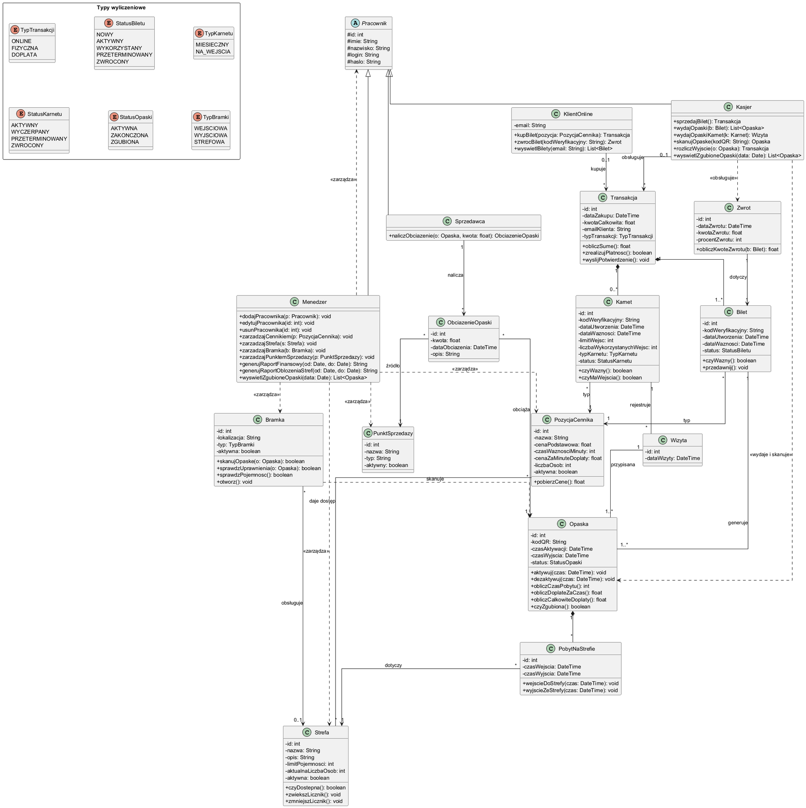
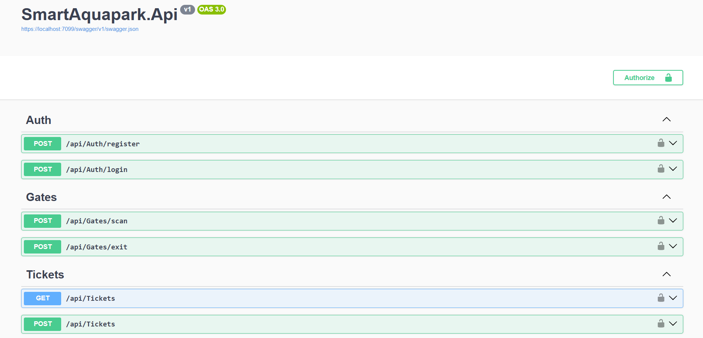
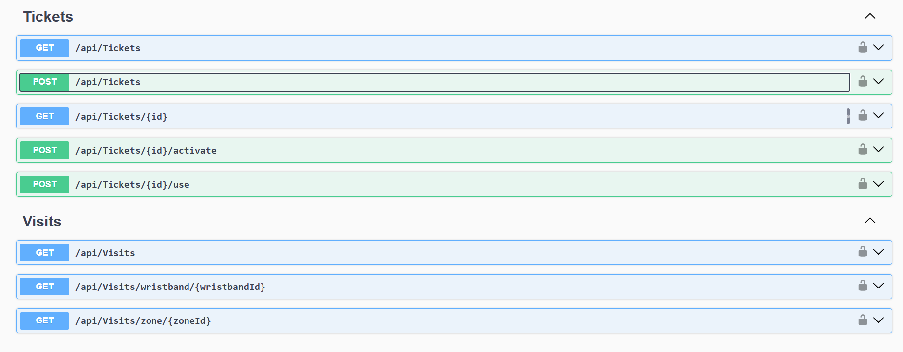
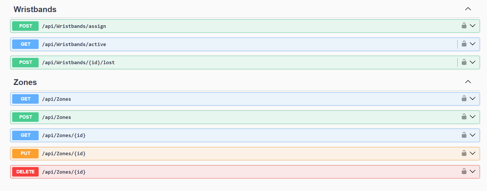
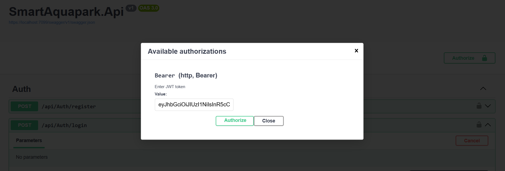
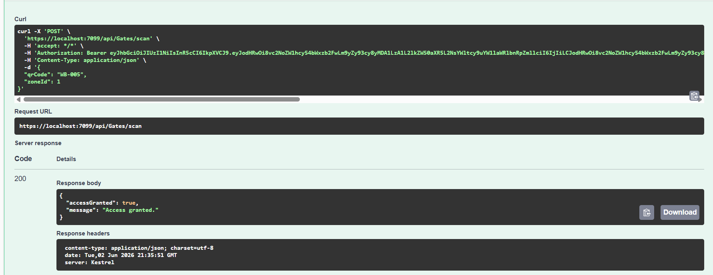
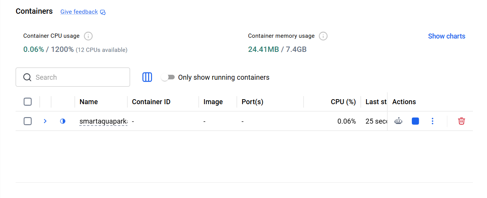

# SmartAquapark API


[](https://github.com/Jasmik221/SmartAquapark.Api/actions/workflows/ci.yml)

---

## Overview

SmartAquapark API is a backend system for managing aquapark operations, including ticket handling, wristband assignment, gate access validation, zone management, and visit tracking.

The project was built using ASP.NET Core and follows a layered architecture with separated Application, Domain, Infrastructure, and API layers.

The system supports JWT authentication, role-based authorization, Docker deployment, PostgreSQL database integration, and automated unit testing.

---

## Features

* JWT Authentication & Authorization
* Role-based access control
* Ticket management system
* Wristband assignment and activation
* Gate access validation
* Zone occupancy management
* Visit history tracking
* Request validation with FluentValidation
* Global exception handling
* Dockerized environment
* Swagger/OpenAPI documentation
* Unit testing with xUnit

---

## Tech Stack

* ASP.NET Core 10
* Entity Framework Core
* PostgreSQL
* JWT Authentication
* Docker & Docker Compose
* FluentValidation
* xUnit
* Swagger / OpenAPI

---

## Architecture

The project follows a layered architecture:

* **SmartAquapark.Api** – controllers and API configuration
* **SmartAquapark.Application** – DTOs and interfaces
* **SmartAquapark.Domain** – entities and enums
* **SmartAquapark.Infrastructure** – database context and services
* **SmartAquapark.Tests** – unit tests

---

## Database & Domain Diagram



---

## API Modules

### Authentication

* User registration
* JWT login

### Tickets

* Create tickets
* Activate tickets
* Use tickets
* Retrieve ticket details

### Wristbands

* Assign wristbands
* Retrieve active wristbands
* Mark wristbands as lost

### Gates

* Validate access to zones
* Handle zone exits
* Occupancy tracking

### Visits

* Retrieve visit history
* Retrieve visits by wristband
* Retrieve visits by zone

### Zones

* CRUD operations for aquapark zones

---

## Screenshots

### Swagger API Overview







---

### JWT Authorization



---

### Gate Access Validation



---

### Docker Environment



---

## Running With Docker

Requirements: Docker with Linux containers, Docker Compose v2, and Python 3.
Run these commands from the repository root:

```bash
python scripts/create-dev-env.py
docker compose up -d --build --wait --wait-timeout 120
python scripts/smoke-test.py
```

The setup script creates a git-ignored `.env` with unique database and JWT credentials.
It preserves an existing `.env`. Alternatively, copy `.env.example` to `.env` and fill
in both credentials (the JWT key needs at least 32 UTF-8 bytes).
Compose waits for PostgreSQL readiness and applies existing EF migrations before
starting the API. No manual database setup is required for a fresh Docker volume.

- Swagger: http://localhost:8080/swagger
- Liveness: http://localhost:8080/health/live
- Readiness (database connection and migrations): http://localhost:8080/health/ready

`API_PORT` and `DB_PORT` can be changed in `.env`. If you change the API port, set
`SMOKE_BASE_URL` when running the smoke test. It creates a uniquely named test account
in the selected database, so use it against a development environment.

Stop with `docker compose down` (database data remains in the named volume).
Do not change the database password in `.env` for an existing volume without also
changing it inside PostgreSQL.

## Running Locally

Requires the .NET 10 SDK and PostgreSQL. Configure secrets with .NET user secrets:

```bash
dotnet user-secrets init --project SmartAquapark.Api
dotnet user-secrets set "ConnectionStrings:DefaultConnection" "Host=localhost;Port=5433;Database=smart_aquapark;Username=postgres;Password=YOUR_LOCAL_PASSWORD" --project SmartAquapark.Api
dotnet user-secrets set "Jwt:Key" "YOUR_RANDOM_KEY_AT_LEAST_32_BYTES_LONG" --project SmartAquapark.Api
dotnet user-secrets set "Database:ApplyMigrationsOnStartup" "true" --project SmartAquapark.Api
dotnet run --project SmartAquapark.Api --launch-profile http
```

Use the HTTP address printed by `dotnet run`. User secrets are loaded in Development.
For EF CLI commands, the design-time factory reads the environment variable
`ConnectionStrings__DefaultConnection`; it does not read `.env` or user secrets.
Automatic startup migrations are an opt-in convenience for the single-instance demo.
For production, run migrations as a separate deployment step and provide secrets via
the deployment environment. This portfolio application is not a production security audit.

## Running Tests

```bash
dotnet test SmartAquapark.Api.slnx -c Release
```

## CI and Container Delivery

Pull requests to `master` and pushes to `master` run:

1. .NET 10 restore with a transitive NuGet vulnerability audit, Release build,
   and xUnit tests with coverage artifacts.
2. Source secret scan, Docker image build, and Trivy vulnerability scan.
3. API + PostgreSQL startup on a fresh CI volume, followed by readiness,
   registration, login, and invalid-password smoke checks.
4. On successful **pushes to master only**, publication of that same tested image
   to `ghcr.io/jasmik221/smartaquapark.api:sha-<full-commit-sha>` and `:latest`.

NuGet high/critical vulnerabilities and audit-source failures stop the pipeline.
Trivy blocks detected source secrets and fixable high/critical image vulnerabilities;
unfixed image vulnerabilities are excluded from this gate, not claimed to be absent.
Scan reports, container diagnostics, test results, and coverage are downloadable
from the workflow run. Pull requests never publish images or log in to GHCR.
Only the publication job receives `packages: write`; authentication uses the built-in
`GITHUB_TOKEN` rather than a manually configured personal token.

[Pipeline walkthrough and troubleshooting](docs/ci-cd.md)

---

## Future Improvements

* Frontend admin panel
* RFID hardware integration
* Reservation system
* Analytics dashboard
* Production deployment environment

---

## Project Status

Completed portfolio backend application demonstrating:

* REST API development
* Authentication & authorization
* Clean architecture concepts
* Business logic implementation
* Docker containerization
* Automated testing
* CI with vulnerability scanning and tested container delivery
